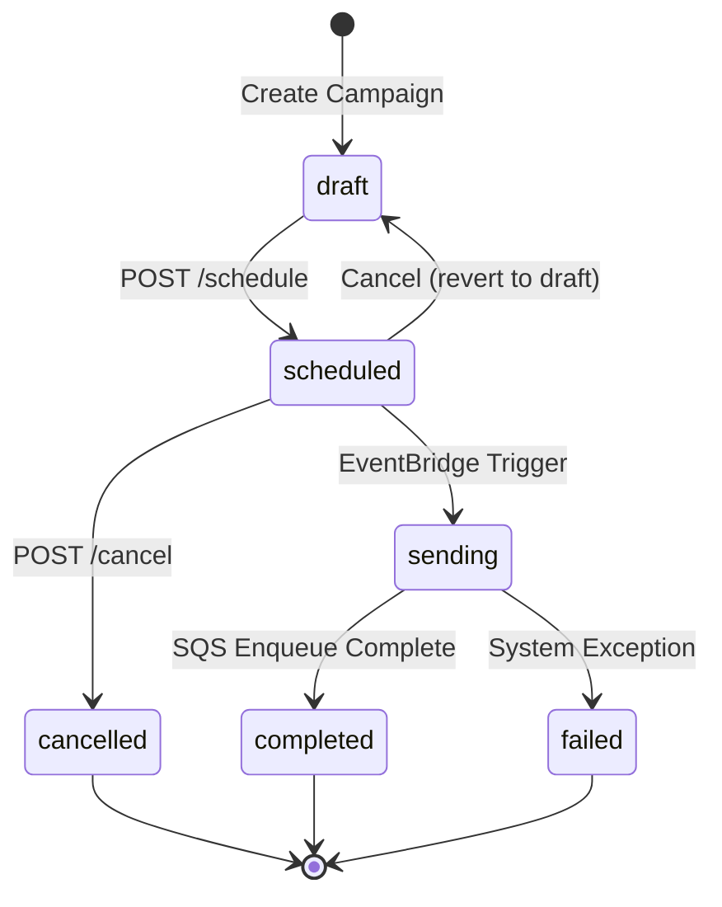
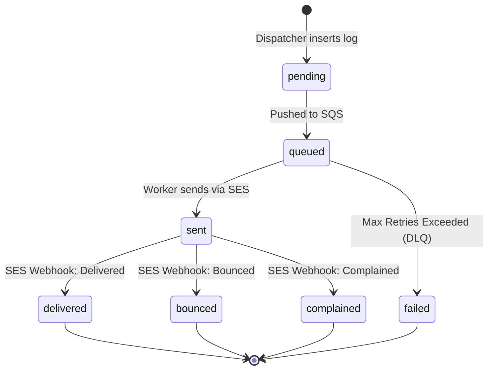

# State Machine Specification: Campaigns & Email Lifecycle

- **Author:** Quang Thinh (Backend API & Database Lead)
- **Applicable Components:** Campaign API Lambda, Dispatcher Lambda, Worker Lambda, Event Handler Lambda
- **Objective:** Enforce deterministic state transitions, prevent duplicate email dispatches (Risk R4), and eliminate race conditions that could corrupt dashboard metrics (US04, US05).

---

## 1. Campaign Status State Machine (`campaigns.status`)

### 1.1 State Definitions
* **`draft`:** Initial state. Editable by Frontend.
* **`scheduled`:** Locked for changes. Waiting for EventBridge trigger.
* **`sending`:** Dispatcher Lambda is publishing messages to Amazon SQS.
* **`completed`:** All recipient jobs have been pushed to SQS and processed.
* **`cancelled`:** Campaign was revoked prior to execution.
* **`failed`:** Dispatcher encountered an unrecoverable system exception.

### 1.2 Transition Matrix

| From State | To State | Trigger | Authorized Component | Validation / Invariant Rule |
| :--- | :--- | :--- | :--- | :--- |
| `[Initial]` | `draft` | Create Campaign | Campaign API Lambda | Payload contains valid name, templateId, and segmentId. |
| `draft` | `scheduled` | `POST /campaigns/{id}/schedule` | Campaign API Lambda | `scheduledAt` must be at least 5 minutes in the future. |
| `scheduled` | `draft` / `cancelled` | `POST /campaigns/{id}/cancel` | Campaign API Lambda | Allowed only before the scheduled execution timestamp. |
| `scheduled` | `sending` | EventBridge Scheduler Trigger | Dispatcher Lambda | Triggered at `scheduledAt`. Locks row via `UPDATE ... WHERE status = 'scheduled'`. |
| `sending` | `completed` | Dispatch Finished | Dispatcher Lambda | All segment recipients iterated and enqueued into Amazon SQS. |
| `sending` | `failed` | Unhandled Error | Dispatcher Lambda | Database connection failure or unrecoverable error during enqueue. |



### 1.3 Rejected / Invalid Transitions
* `completed` $\rightarrow$ `sending` (Forbidden: Cannot re-trigger a finished campaign).
* `sending` $\rightarrow$ `scheduled` (Forbidden: Cannot revert in-flight campaigns).
* Any direct API edit while in `sending` or `completed` returns `HTTP 409 Conflict`.

---

## 2. Email Delivery State Machine (`email_logs.send_status`)

### 2.1 State Definitions
* **`pending`:** Initial log created by Dispatcher representing an eligible recipient.
* **`queued`:** Message confirmed in Amazon SQS main queue.
* **`sent`:** Amazon SES accepted the message (`SendEmail` returned `ses_message_id`).
* **`delivered`:** SES Event Notification confirms mailbox receipt.
* **`bounced`:** Hard or soft bounce event published by SES.
* **`complained`:** Recipient marked message as spam/abuse.
* **`failed`:** Worker retry exhaustion or fatal sending error (e.g., malformed email).

### 2.2 Transition Matrix

| From State | To State | Trigger Event | Authorized Component | Safety & Idempotency Rules |
| :--- | :--- | :--- | :--- | :--- |
| `[None]` | `pending` | Recipient Extraction | Dispatcher Lambda | Generate deterministic `idempotency_key = SHA256(campaign_id + customer_id)`. |
| `pending` | `queued` | Enqueued to SQS | Dispatcher Lambda | Enqueued with deduplication message attributes. |
| `queued` | `sent` | SES `SendEmail` returns 200 | Worker Lambda (Viet Anh) | Row updated with `ses_message_id`. Atomic update via `idempotency_key`. |
| `sent` | `delivered` | SES Event: `Delivery` | Event Handler Lambda (The Nam) | Matches via `ses_message_id`. Increases campaign delivered metric. |
| `sent` | `bounced` | SES Event: `Bounce` | Event Handler Lambda (The Nam) | Upserts into `email_suppressions` if bounceType is `Permanent`. |
| `sent` | `complained`| SES Event: `Complaint` | Event Handler Lambda (The Nam) | Mandatory immediate insertion into `email_suppressions`. |
| `queued` | `failed` | Max SQS retries reached | SQS Dead-Letter Queue (DLQ) | Attempt count $\ge 3$. Logged with `last_error`. |



### 2.3 Idempotency Enforcement (Risk R4 Mitigation)
* **Terminal States:** `delivered`, `bounced`, and `complained` are terminal. Out-of-order webhook events arriving after a terminal state has been recorded are ignored using conditional updates:
  ```sql
  UPDATE email_logs 
  SET send_status = :new_status, updated_at = NOW() 
  WHERE email_log_id = :id AND send_status NOT IN ('delivered', 'bounced', 'complained');
  ```