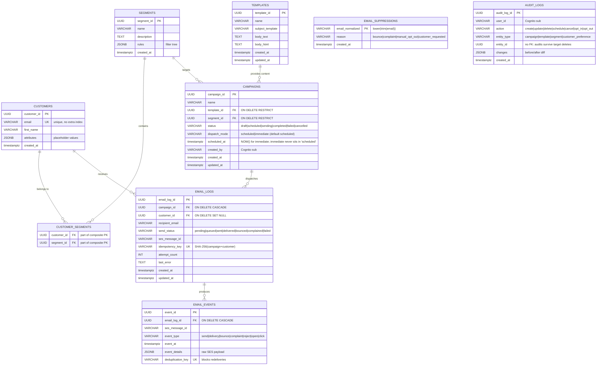

# Database ERD

- **Purpose:** Visual confirmation of the 9-table Aurora PostgreSQL schema (`db/schema.sql`). One row = one table; arrows = foreign keys.
- **Source of truth:** `db/schema.sql`.

## Relationship summary

| Relationship | Cardinality | Delete behavior |
|---|---|---|
| segments → customer_segments → customers | M:N via junction | CASCADE on both sides |
| segments → campaigns | 1:N | RESTRICT (referenced segment cannot be deleted) |
| templates → campaigns | 1:N | RESTRICT (referenced template cannot be deleted) |
| campaigns → email_logs | 1:N | CASCADE |
| customers → email_logs | 1:N | SET NULL (history kept, `recipient_email` denormalized) |
| email_logs → email_events | 1:N | CASCADE |
| email_suppressions | standalone | keyed on normalized email, no FK |
| audit_logs | standalone | `entity_id` is a bare UUID, no FK |

`email_suppressions` and `audit_logs` are intentionally connection-free tables: suppressions are looked up by email string, audit rows must outlive the entities they describe.
